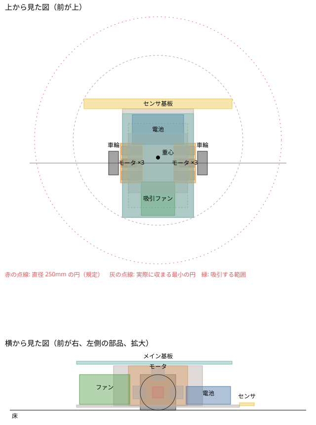

# 機体の配置

## 案 v0（2026-10-21）

部品を箱（直方体）で置いて、重さ、重心、慣性モーメント、外形を計算した。スクリプトは `hardware/mechanical/layout/layout.py`。

```sh
python3 hardware/mechanical/layout/layout.py docs/img/layout_v0.svg
```



座標は **車軸の中心の真下が原点**、+x が前、+y が左、z が上（床が 0）。単位は mm。

### 部品の置き場所

| 部品 | 位置 | 理由 |
|---|---|---|
| 車輪（φ24、幅 10） | 中心 y = ±45（**トレッド 90mm**）、外側の面 y = ±50 | |
| 走行用モータ 1 輪 3 個 | 車軸のまわりの **前（0°）・上（90°）・後ろ（180°）**、車軸から 12.6mm（13T:71T）。y = ±17〜37 | 前と後ろのモータの下端は床から 7.7mm。上のモータの上端は z = 28.9 |
| エンコーダ MES-6 | **車軸と同じ軸**で、3 個のモータに囲まれた内側（y = ±22〜36） | 車軸と 1:1 でつなぎやすい。モータとのすき間は 12.6 − 4.3 − 3.75 ≒ 4.5mm |
| 電池（2S 300mAh、仮に 52 × 30 × 12mm） | 車軸の前、フレームの上（x = 19〜49） | 重いので低く置く。センサ基板と釣り合わせて、重心を車軸の近くに |
| 吸引ファン（φ33） | 車軸の後ろ（x = −53〜−19） | 車軸のまわりはモータとエンコーダで埋まっている |
| メイン基板 | モータの上（z = 31〜33）、x = −55〜50、幅 72 | MCU、ドライバ、**IMU × 2 は車軸の真上（旋回の中心の近く）、基板の表と裏** |
| センサ基板 | 前（x = 55〜65）、幅 150（ラインセンサ 14 ＋ マーカー 2） | |
| フレーム（吸引する面） | 床から 2mm、x = −55〜55 | 吸引する範囲は **85 × 60mm（51cm²）**。車輪の内側、モータの下 |

### 計算の結果

| 項目 | 値 | メモ |
|---|---|---|
| 重さ | 101.3g | [mass.md](mass.md) の配分と同じ（1.3g 超過） |
| 重心 | x = **+5.6mm**（車軸の少し前）、z = 14.2mm | 車軸の近く。前後の滑り板にかかる力がほぼ揃う |
| ヨーの慣性モーメント | 約 1,330 g·cm² | Mk4（約 290 g·cm²）の 4〜5 倍。電池とセンサ基板が前にあり、機体が大きいため |
| 床への投影が収まる最小の円 | **直径 172mm** | 規定（250mm）まで余裕がある |
| 機体の最大の横幅 | 150mm（センサ基板） | ラインから機体の中心を最大 **±84mm** 離せる（仮想ライントレースのショートカットの幅） |

### センサ基板を広げる案（仮想ライントレース向け）

- 直径 25cm の円には、まだ余裕がある。センサ基板を **幅 240mm** にしても、収まる最小の円は直径約 240mm（円の中心をセンサ基板の近くに置く形）
- そうすると、ラインから機体の中心を最大 **±約 130mm** 離せる（今の 1.5 倍）
- 上位機で幅 240〜250mm と申告している機体（VLT-2 170 × 245、APOLLON 170 × 245 など）と同じ形になる
- 代わりに、重さ（基板が長くなる）、慣性モーメント、ぶつけたときの壊れやすさが増える。ラインセンサは中央 14 個のままで、外側は細い基板か部材にする

### 気をつけること

- **急カーブでのマーカーの誤検出**: センサ基板が車軸の 60mm 前なので、R100 で機体の向きとラインの接線が約 17.5° ずれる。マーカーセンサ（ライン中心から 70mm）がラインを拾うおそれ → ソフトの判定で防ぐ（[line_sensor.md](line_sensor.md)）
- **センサ基板はぶつけやすい**: 一番前に出ているので、マグネットコネクタで外れるようにする案を検討する
- **ファンの振動**: IMU（車軸の真上）とファン（後ろ）は 40mm ほど離れている。緩衝材などの対策は試作で確かめる
- **電池の大きさ**: 仮の寸法。実物で置き直す
- 箱で近似しているので、慣性モーメントや重心は目安。3D CAD に移したら計算し直す

## 決めること

1. トレッド（車輪の間隔）90mm でよいか
2. センサ基板の位置（車軸の 60mm 前）と幅（150mm か、240mm に広げるか）
3. 電池を前、ファンを後ろに置く並びでよいか
